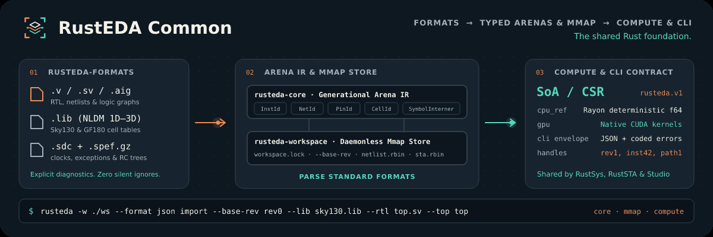

<h1 align="center">The foundation beneath the design loop.</h1>

<a href="https://lab-emi.github.io/RustEDA/modules/rusteda-common/">Documentation</a> · <a href="https://github.com/lab-emi/RustEDA">RustEDA</a> · <a href="LICENSE">Apache-2.0</a>

<picture>
<source media="(prefers-reduced-motion: reduce)" srcset="docs/assets/rusteda-common-banner.svg">

</picture>

The single implementation source for the shared RustEDA foundation:

- rusteda-core: typed arenas, symbols, diagnostics, library and netlist models.
- rusteda-workspace: disk revisions, binary tables, locks and CLI envelopes.
- rusteda-formats: Verilog, Liberty, SDC, SPEF, BLIF and AIGER readers/writers.
- rusteda-compute: deterministic CPU kernels and optional native CUDA support.
- rusteda-cli-common: the shared workspace CLI implementation.

Product repositories depend on an exact Git revision of this repository. A small
product-owned rusteda-cli adapter preserves its binary name and product version; implementation
and core tests live here. Sources are available over HTTPS.

The initial implementation comes from the byte-matched RustSys/RustSTA foundation at
d36d922c0201968745be72bd71aff57ace393c90 / 455c43c9bd6afa0e0a538822d3fc2822d6e26880.
This extraction changes dependency ownership, not EDA algorithms or persisted formats.

Use the RustEDA superproject's bounded development commands. Direct Cargo commands also work:

~~~sh
cargo test --workspace --locked
cargo test -p rusteda-compute --features cuda
~~~

Optional GPU and external-oracle checks are not implied by CPU test success.
The core crates have no Python or GUI dependency. See the [development guide](https://lab-emi.github.io/RustEDA/development/).

## RustEDA Common at a glance

Ibex RTL-to-GDS on IHP SG13G2 with EZ130 cells and two SRAM macros, 2026-11-05: RustEDA and LibreLane 3.0.17 (OpenROAD, Yosys, KLayout, Magic, Netgen) ran one after the other on the same 4-vCPU host from the same prepared inputs, and the same signoff scripts checked both layouts.

- The formats, workspace and RC kernels in this repository sit under every RustEDA result: the flow finishes **4.2× sooner end to end** than LibreLane with a **5.2 % smaller, 7.4 % shorter-wired** layout.
- RustSTA, built on its SPEF, Liberty and workspace layers, runs **1.6×–2.0× faster than OpenSTA** with less peak memory; RustSys, on its netlist and Liberty models, synthesizes **35.4× faster than Yosys + ABC**.

LibreLane's layout fails the shared timing gate (112 maximum-capacitance and fanout violations at TT and SS) and its equivalence check does not complete, so the receipt keeps its own ratio fields null under its publication rule; the multiples here divide the recorded times. Stages are paired by phase, not as identical tasks. RustEDA is not faster everywhere: its repair before global routing takes 1.18× LibreLane's two pre-route resizer steps alone, OpenRCX runs 1.36× longer on RustEDA's DEF, and the latch-up check 1.11× longer on its layout. [All stages, gates and losses](https://lab-emi.github.io/RustEDA/benchmarks/)

## PULPissimo benchmark scope

RustEDA's [PULPissimo benchmark](https://lab-emi.github.io/RustEDA/benchmarks/pulpissimo/) is **synthesis-only** and exercises the shared RustEDA foundation only through RustSys. It compares the PULPissimo Ibex core with a bounded Yosys 0.70/ABC reference on SKY130 HD; the full PULPissimo SoC still exceeds a 2 h synthesis budget on SKY130 with behavioral L2 memory; an IHP SG13G2 / EZ130 synthesis-only test with 80 official SRAM macros completes in 426 s, but neither is a physical signoff result. The result does not add a Common-specific speed or memory claim.

## Latest development · 2026-11-01

The foundation now includes the IHP/SRAM interface work used by the qualified
Ibex flow: Liberty memory buses and pin metadata, explicit driving-cell
constraints, escaped mapped-netlist identifiers, and bounded connectivity
exports. The deterministic CPU RC charge-fitting implementation uses `f64`.

[Current source and qualification](docs/development-status.md) ·
[Latest complete-flow evidence](https://lab-emi.github.io/RustEDA/benchmarks/)
