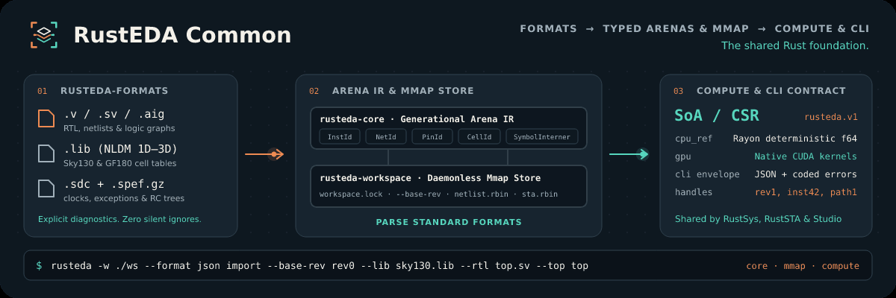

# RustEDA Common

Shared typed models, file formats, disk workspaces, CLI contracts and deterministic compute kernels.

[All RustEDA modules](https://lab-emi.github.io/RustEDA/)

<picture>
<source media="(prefers-reduced-motion: reduce)" srcset="assets/rusteda-common-banner.svg">

</picture>

- [Core models](specs/core/README.md)
- [Workspace](specs/workspace/README.md)
- [Compute](specs/compute/README.md)
- [Verilog](specs/verilog/verilog.md)
- [Liberty](specs/liberty/liberty.md)
- [SDC](specs/sdc/sdc.md)

## RustEDA Common at a glance

Ibex RTL-to-GDS on IHP SG13G2 with EZ130 cells and two SRAM macros, 2026-11-13: RustEDA and LibreLane 3.0.17 (OpenROAD, Yosys, KLayout, Magic, Netgen) ran one after the other on the same 4-vCPU host from the same prepared inputs, and the same signoff scripts checked both layouts. Every RustEDA engine was built with Rust 1.100.0; RustSys and RustSTA were built against this repository at [`002f8f6`](https://github.com/lab-emi/RustEDA-Common/commit/002f8f69f6adcec4c75973dbdccb42f04cdd7a37).

- This repository has [no head-to-head of its own](https://lab-emi.github.io/RustEDA/benchmarks/#rusteda-common-2026-11-13): it is compiled into RustSys and RustSTA, including the `rusteda` workspace CLI used by the producer's frontend and timing steps and by the shared timing gate. In the flow, RustSys synthesis is **40.3× faster** than LibreLane's (3.10 s against 124.93 s), repair before detailed routing **3.5× faster** (13.85 s against 48.36 s) and static timing, RustSTA with its OpenSTA parity check, **5.2× faster** (26.96 s against 138.93 s).
- The whole flow finishes **4.4× sooner end to end** (751.54 s against 3,283.05 s with both flows' foundry checks on the same schedule; 3.5× with every check run one after another) with a **5.2 % smaller, 7.7 % shorter-wired** layout, 1.3 % fewer vias, zero timing violations where LibreLane's has 112, and synthesis and final equivalence proven.

LibreLane's layout fails the shared timing gate (112 maximum-capacitance and fanout violations at TT and SS) and its equivalence check does not complete, so the receipt keeps its own ratio fields null under its publication rule; the multiples here divide the recorded times. Stages are paired by phase, not as identical tasks. Against the three losses of 2026-11-05, in same-load runs: repair before global routing now takes 0.73× the time of LibreLane's two pre-route resizer steps (ranges do not overlap; 1.18× on 2026-11-05), OpenRCX on RustEDA's layout is level with its time on LibreLane's (1.00×, ranges overlap; 1.36× on 2026-11-05) and the latch-up check on RustEDA's layout takes 0.76× its time on LibreLane's (1.11× with the checker of that campaign). RustEDA is still not faster or not better everywhere: RustROAD's standalone extraction took 1.22× OpenRCX's time at 4 threads in the campaign and, after three changes since, is narrowly faster at 4 threads (0.85×, faster in all 30 runs of two A/Bs; the ranges are apart in one and overlap by 47 ms in the other) and still 1.52× slower at 2 ([third round](https://lab-emi.github.io/RustEDA/benchmarks/#rustroad-extraction-third-round-2026-11-14)); the shared timing gate, which uses this repository's `rusteda` CLI, is level (0.98×, ranges overlap) and its layout keeps less hold margin (TT 0.108 ns against 0.172 ns; both meet hold). RustSTA's peak memory at 4 threads, 11.8 % above OpenSTA's in the campaign, is 12.6 % below it since a change after the campaign ([details](https://lab-emi.github.io/RustEDA/benchmarks/#ruststa-peak-memory-and-rustroad-extraction-2026-11-13)). [All stages, gates and losses](https://lab-emi.github.io/RustEDA/benchmarks/#ibex-host-campaign-2026-11-13) · [Where RustEDA still loses or is at parity](https://lab-emi.github.io/RustEDA/benchmarks/#where-rusteda-still-loses-or-is-at-parity-2026-11-13)

## PULPissimo benchmark scope

The [PULPissimo benchmark](https://lab-emi.github.io/RustEDA/benchmarks/pulpissimo/) is synthesis-only and exercises the shared foundation only through RustSys. It compares the PULPissimo Ibex core with a bounded Yosys 0.70/ABC reference on SKY130 HD; it adds no Common-specific speed or memory claim, and the full PULPissimo SoC still exceeds a 2 h synthesis budget on SKY130 with behavioral L2 memory; an IHP SG13G2 / EZ130 synthesis-only test with 80 official SRAM macros completes in 426 s, but neither is a physical signoff result.

## Development update · 2026-11-13

The foundation now carries what the Ibex campaigns of 2026-11-05 and 2026-11-13
ran on:

- **Import.** `rusteda import` parses each distinct SPEF source once and shares
  its text between corners, checks a source given again against its earlier
  text while reading it, and keeps the nodes of a net and the name map in a few
  large buffers; a count-only parse checks a source without keeping its nets.
  `--lib-cache DIR` shares compiled Liberty libraries between workspaces as
  copies bound to the recorded compile, never links (RCLI-REQ-0025), and the
  streaming netlist reader connects the bit pins of a bus.
- **RC.** The root and sink crossing bisections are replayed with a certified
  bound, and the crossings share their `expm1` and pole-ramp factors.
- **Command line.** `rusteda estimate-spef` is the native form of the Ibex
  recipe's placement RC estimate (RCLI-REQ-0026); `rusteda eco-round` plans and
  applies one ECO round of the native frontend (RCLI-REQ-0027); and
  `frontend-profiles`, `frontend-physical`, `frontend-pins` and
  `frontend-validate` are its other helpers (RCLI-REQ-0028). Each writes the
  reference helper's files byte for byte from the same inputs, checked against
  the helpers on a small run.
- **Toolchain.** Rust 1.100.0; fixed-size records are read with `as_chunks`.

[Current source and qualification](development-status.md) ·
[Latest complete-flow evidence](https://lab-emi.github.io/RustEDA/benchmarks/#ibex-host-campaign-2026-11-13)

## Development update · 2026-11-01

The foundation now includes the IHP/SRAM interface work used by the qualified
Ibex flow: Liberty memory buses and pin metadata, explicit driving-cell
constraints, escaped mapped-netlist identifiers, and bounded connectivity
exports. The deterministic CPU RC charge-fitting implementation uses `f64`.

[Source, evidence and remaining limits](development-status.md)
