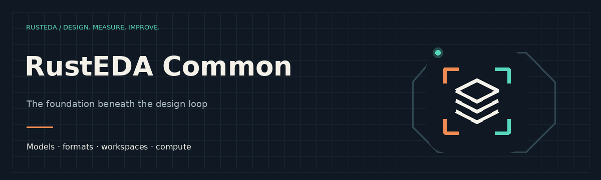

# RustEDA Common

Shared typed models, file formats, disk workspaces, CLI contracts and deterministic compute kernels.

[All RustEDA modules](https://lab-emi.github.io/RustEDA/)

<picture>
<source media="(prefers-reduced-motion: reduce)" srcset="assets/rusteda-common-banner.svg">

</picture>

- [Core models](specs/core/README.md)
- [Workspace](specs/workspace/README.md)
- [Compute](specs/compute/README.md)
- [Verilog](specs/verilog/verilog.md)
- [Liberty](specs/liberty/liberty.md)
- [SDC](specs/sdc/sdc.md)
